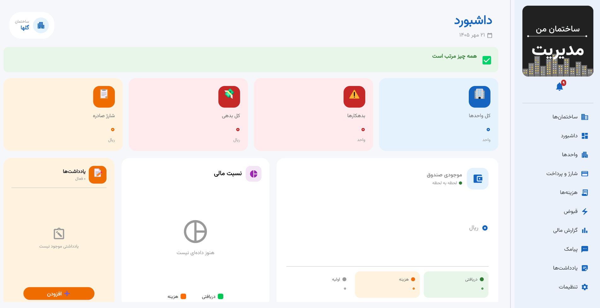
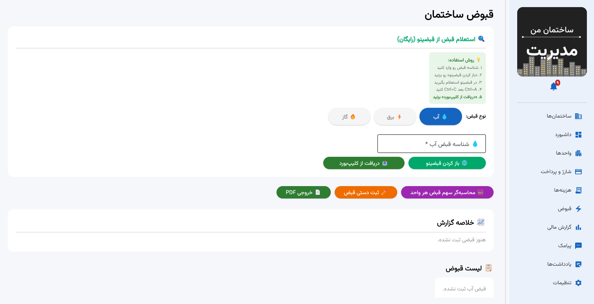
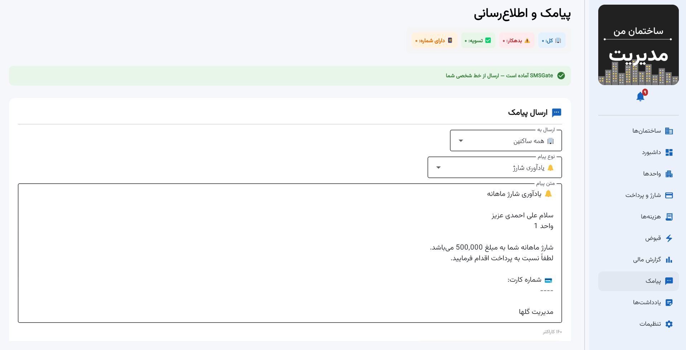

<div align="center">

# 🏢 سیستم مدیریت ساختمان

**نرم‌افزار جامع مدیریت شارژ، هزینه‌ها، قبوض و ارتباط با ساکنین**

[](https://python.org)
[](https://flet.dev)
[](https://sqlite.org)
[](https://www.gnu.org/licenses/gpl-3.0)

<br>

[✨ ویژگی‌ها](#-ویژگیها) · [🚀 نصب](#-نصب-و-اجرا) · [📸 تصاویر](#-تصاویر) · [📄 لایسنس](#-لایسنس)

</div>

---

## 📖 معرفی

نرم‌افزار **سیستم مدیریت ساختمان** یک اپلیکیشن دسکتاپ جامع برای مدیران ساختمان‌های مسکونی است که فرآیندهای مدیریتی و مالی را ساده و شفاف می‌کند.

> ساخته شده با ❤️ با Python و Flet

---

## ✨ ویژگی‌ها

### 💰 مدیریت مالی
- **شارژ ماهانه**: صدور خودکار، محاسبه بر اساس متراژ/نفرات/مبلغ ثابت
- **پرداخت‌ها**: ثبت پرداخت با OCR فیش بانکی
- **هزینه‌ها**: دسته‌بندی، نمودار دایره‌ای، گزارش ماهانه
- **قبوض**: استعلام آب/برق/گاز، ثبت خودکار در هزینه‌ها

### 📊 گزارش و تحلیل
- **داشبورد پیشرفته**: آمار لحظه‌ای، نمودارهای سه‌بعدی
- **گزارش مالی**: خروجی PDF حرفه‌ای
- **رتبه‌بندی نظم پرداخت**: امتیازدهی خودکار
- **تقویم مالی**: رویدادهای ۳۰ روز آینده

### 📱 ارتباطات
- **پیامک**: ارسال از خط شخصی با SMSGate
- **قالب‌های آماده**: یادآوری، تشکر، اخطار، دعوت جلسه
- **پیامک خودکار**: هنگام پرداخت، سررسید، عدم پرداخت

### 🛠️ سایر
- **یادداشت‌ها**: سیستم یادآوری
- **کاربرگ واحد**: خروجی PDF اختصاصی هر واحد
- **بکاپ خودکار**: با یک کلیک
- **تم تاریک/روشن**

---

## 📸 تصاویر

<div align="center">

### 🖥️ داشبورد


### 💰 شارژ و پرداخت


### 📋 قبوض


### 📱 پیامک


</div>

---

## 🚀 نصب و اجرا

### پیش‌نیازها
- Python 3.11 یا بالاتر
- ویندوز ۱۰/۱۱
- یک گوشی اندروید با اپ [SMSGate](https://sms-gate.app) (برای ارسال پیامک)


### مراحل نصب

فایل نصبی را دانلود و نصب کنید.


## 📁 ساختار پروژه

```
building_manager/
├── app.py                    # فایل اصلی (رابط کاربری)
├── services.py               # منطق و توابع دیتابیس
├── models.py                 # مدل‌های SQLAlchemy
├── database.py               # راه‌اندازی دیتابیس
├── receipt_parser.py         # پارسر رسید دیجیتال
├── bill_parser.py            # پارسر قبوض
├── pdf_generator.py          # تولید PDF
├── chart_generator.py        # نمودارهای سه‌بعدی
├── tray.py                   # System Tray
├── notify.py                 # نوتیفیکیشن
├── fonts/                    # فونت‌های Vazirmatn
└── requirements.txt
```

---

## 🛠️ تکنولوژی‌های استفاده‌شده

| تکنولوژی | کاربرد |
|----------|--------|
| **Python 3.11** | زبان اصلی |
| **Flet** | رابط کاربری دسکتاپ |
| **SQLAlchemy** | ORM دیتابیس |
| **SQLite** | دیتابیس |
| **EasyOCR** | تشخیص متن فارسی |
| **Tesseract** | OCR پشتیبان |
| **ReportLab** | تولید PDF |
| **Pillow** | پردازش تصویر |
| **SMSGate** | ارسال پیامک |

---

## ⚠️ نکات امنیتی

- این پروژه **دیتابیس شما را آپلود نمی‌کند**. فایل `building_manager.db` توی `.gitignore` قرار دارد.
- برای ارسال پیامک، نیاز به یک گوشی اندروید با اپ SMSGate دارید که به اینترنت وصل باشد.
- از قرار دادن رمزها در کد خودداری کنید — همه‌ی اطلاعات حساس در دیتابیس محلی ذخیره می‌شوند.

---

## 📄 لایسنس

این پروژه تحت لایسنس **GNU GPL v3.0** منتشر شده است.

✅ آزاد برای: استفاده شخصی، یادگیری، تغییر، توزیع با ذکر منبع  
❌ ممنوع برای: استفاده تجاری بسته بدون انتشار کد

جزئیات کامل در فایل [LICENSE](LICENSE).

---

## 👤 توسعه‌دهنده

**[AmirEP]**

- 🔗 گیت‌هاب : https://github.com/Amirosein2001
- 📧 ایمیل: Amirep2001@gmail.com

---

<div align="center">

**⭐ اگر این پروژه به کارت آمد، یه ستاره بزن! ⭐**

Copyright © 2026 AmirEP. All Rights Reserved under GPL v3.0.

</div>
